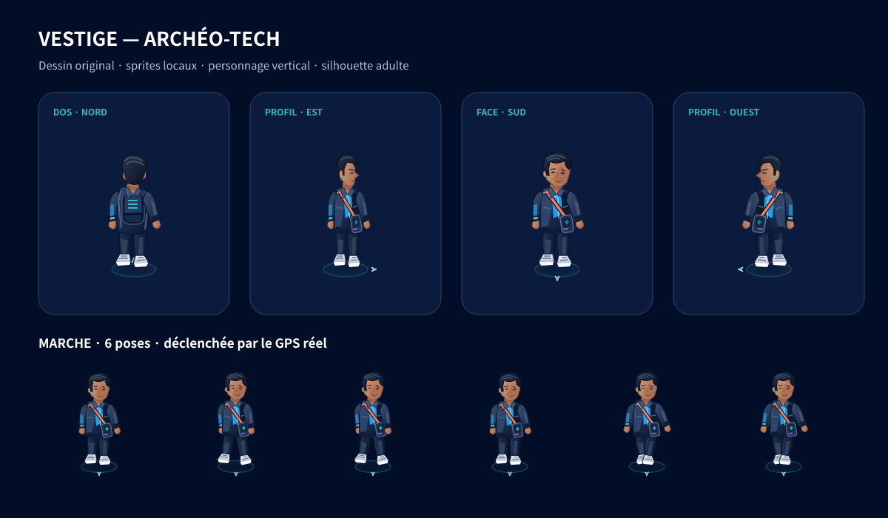

# VESTIGE — Nouvel avatar archéo-tech

Branche : `codex/premium-explorer-avatar`, basée sur la dernière version complète de la charte officielle avec le vrai logo intégré. Les PR précédentes ne sont pas fusionnées automatiquement.

## Les trois propositions

| Direction                          | Style                                                  | Silhouette                                    | Tenue                                                        | Couleurs                                                                 | Accessoires                                             | Intérêt pour VESTIGE                                                                  |
| ---------------------------------- | ------------------------------------------------------ | --------------------------------------------- | ------------------------------------------------------------ | ------------------------------------------------------------------------ | ------------------------------------------------------- | ------------------------------------------------------------------------------------- |
| Explorateur urbain moderne         | Sobre, volumes légèrement ombrés                       | Élancée, adulte, proportions lisibles         | Veste courte, pantalon fuselé et baskets                     | Bleu nuit, bleu lumineux, touches turquoise                              | Sac compact et téléphone de terrain                     | Crédible dans les rues de Lyon/Vienne ; clair à petite taille                         |
| Aventurier stylisé                 | Illustration plus organique et chaleureuse             | Robuste, volumes souples                      | Veste de terrain et bottines                                 | Bleu profond, corail, gris bleuté                                        | Sac, foulard, carnet                                    | Rend l’exploration évidente mais reste proche du personnage précédent                 |
| Explorateur du temps / archéo-tech | 2.5D vectorielle, ombres propres, technologie discrète | Élancée, sans grosse tête ni chapeau dominant | Veste technique structurée, pantalon fuselé, baskets claires | Bleu nuit/profond, doublure violette, sangle corail et scanner turquoise | Scanner de vestiges à la hanche, bracelet et sac dorsal | Identité de jeu originale, avec un lien entre patrimoine et exploration contemporaine |

**Choix intégré : archéo-tech**, avec une tenue contemporaine. Aucun casque, armure lourde ou effet futuriste envahissant. Aucun personnage, vêtement ou asset Pokémon n’a été réutilisé.



Cette planche est un aperçu des ressources dessinées pour cette version, pas une capture de l’iPhone.

## Réalisation visuelle

Le dessin est original, décrit dans `scripts/build-avatar.mjs` : silhouettes vectorielles, panneaux de vêtement ombrés, visage sobre, sangle, scanner et sac. Les exportations PNG transparentes sont disponibles en densités 1×/2×/3× ; aucun rendu SVG ou moteur 3D ne tourne dans l’application.

- Le personnage reste **vertical à l’écran**, y compris quand la carte pivote ou s’incline.
- Le cap est projeté relativement à la caméra sur iOS **et** Android : quatre silhouettes (face, dos, côtés), avec repère de direction au sol en huit secteurs. Ce n’est pas un modèle 3D tournant librement.
- En l’absence de direction fiable : vue neutre, sans flèche inventée.
- L’ombre elliptique donne un contact au sol ; un halo turquoise discret donne de la profondeur.
- Le cercle géographique existant de 100 m reste centré sur les coordonnées GPS réelles. Le petit halo du dessin est décoratif et n’indique pas une distance en mètres.
- HUD et Profil emploient un portrait du même personnage, plus lisible que l’ancien corps miniature.

## Animations opérationnelles dans le code

### Idle

Quatre images de respiration discrète : petit mouvement de buste, intensité du scanner et halo. Cadence d’environ 1,4 image/s ; les coordonnées GPS ne sont jamais modifiées par la respiration.

### Marche

Six poses avec jambes et bras alternés, cadence maximale 8 images/s. Deux relevés récents et suffisamment précis sont nécessaires : précision ≤ 35 m sur les deux, petit déplacement confirmé, vitesse compatible avec la marche/course légère. Une vitesse stationnaire connue bloque la marche. Sans vitesse disponible, le déplacement doit dépasser une marge d’incertitude GPS.

Pas de marche sur un gros saut de position, une reprise de précision, un relevé ancien ou une vitesse supérieure à 5 m/s. Le dernier mouvement confirmé peut être conservé entre les relevés, au maximum 6,5 secondes, puis l’avatar revient à l’idle. La latence d’arrêt dépend donc aussi de la fréquence des relevés ; aucune position future n’est extrapolée.

Le déplacement du marqueur entre les coordonnées mesurées reste interpolé par le mécanisme existant. Le cap GPS de déplacement est prioritaire sur le cap du téléphone ; la boussole calibrée reste un repli lorsque le cap de déplacement n’est pas exploitable.

### Limitation du travail en arrière-plan

Les images animées concernent un seul marqueur. Aucune boucle de captures de sous-vues `react-native-maps` n’est utilisée : les images natives changent avec `tracksViewChanges=false`.

- Pas d’animation hors Explorer, pendant la lecture d’une fiche ou des options.
- Pas de boucle si « Réduire les animations » est activé.
- Le marqueur est retiré quand la position est absente/périmée ; les timers sont nettoyés au démontage.
- Préchargement des dix images de la direction courante avec `expo-asset`. En cas d’échec, avatar statique : la carte n’est pas bloquée.
- En développement Expo Go, les images peuvent être chargées au premier passage depuis Metro ; les ressources sont incluses dans les exports natifs, sans service externe d’avatars.
- Les 273 PNG, toutes densités incluses et portrait compris, pèsent environ 4,6 Mio dans les sources. La direction courante est préchargée, pas toutes les poses simultanément.

Les performances réelles (fluidité/batterie/mémoire) restent à mesurer sur téléphone ; aucun benchmark iPhone n’est revendiqué.

## Fichiers modifiés et architecture

| Fichier                                                | Rôle                                                                            |
| ------------------------------------------------------ | ------------------------------------------------------------------------------- |
| `src/components/exploration/ExplorerAvatar.tsx`        | Portrait/full-body réutilisable pour HUD/Profil                                 |
| `src/components/exploration/PlayerMarker.tsx`          | Placement natif au sol, images et interpolation GPS                             |
| `src/components/exploration/avatar/sprites.ts`         | Registre généré de `require` statiques, compatible Metro                        |
| `src/components/exploration/avatar/useAvatarFrame.ts`  | Horloge idle/marche, nettoyage des timers et pause                              |
| `src/components/exploration/avatar/useAvatarAssets.ts` | Préchargement/caches par direction et repli statique                            |
| `src/lib/avatar.ts`                                    | Orientation écran, paramètres du personnage et critères de marche               |
| `src/lib/exploration.ts`                               | Priorité au cap GPS en déplacement                                              |
| `src/app/(tabs)/index.tsx`                             | Activation limitée à Explorer et cap caméra sur les deux plateformes            |
| `assets/avatars/archaeotech/`                          | PNG transparents, portrait, SVG de référence et manifeste                       |
| `scripts/build-avatar.mjs`                             | Source artistique et générateur de sprites                                      |
| `tests/avatar.test.ts`                                 | Conditions de marche, direction, intégrité/dimensions des sprites et budget PNG |
| `package.json`, `package-lock.json`, `app.json`        | Préchargement Expo et outil de génération hors application                      |
| `README.md`, `DESIGN_SYSTEM.md`, ce document           | Usage et limites actualisés                                                     |

Dépendance de l’application : `expo-asset ~58.0.20`, déjà fournie par l’écosystème Expo SDK 58 et incluse dans Expo Go. L’outil `@resvg/resvg-js` est une **dépendance de développement Node**, utilisée uniquement pour exporter les PNG ; il n’est ni importé ni exécuté sur le téléphone. Aucun développement build supplémentaire n’est requis pour cette approche.

Pour régénérer les fichiers artistiques : `npm run avatar:build`. Les PNG étant versionnés, cette commande n’est pas nécessaire pour tester l’application.

## Préservation

Le projet existant, le logo officiel, les monuments, la validation des découvertes, le carnet et les XP sont conservés. Aucune modification de la clé `vestige.journal.v1`, des règles de proximité, des sources historiques ou des permissions. Aucune coordonnée fictive ni mode démonstration injecté dans la carte.

## Récupération sous Windows

ZIP complet : https://github.com/zaven69-ai/vestige/archive/refs/heads/codex/premium-explorer-avatar.zip

1. Arrêter Expo avec Ctrl+C et sauvegarder le dossier Windows actuel.
2. Extraire le ZIP et copier ses fichiers dans le dossier du projet existant. Ne pas supprimer le dossier ni désinstaller Expo Go.
3. Avec Node.js 24 LTS, dans le dossier contenant `package.json` :

   ```bat
   npm ci
   npx expo start --clear
   ```

4. Scanner le QR code avec le même iPhone et Expo Go compatible SDK 58. Utiliser si possible la même adresse réseau/port pour conserver l’expérience Expo Go et son stockage local.

Avec Git, après sauvegarde des modifications locales : `git fetch origin`, puis `git switch --track -c codex/premium-explorer-avatar origin/codex/premium-explorer-avatar`. Une branche déjà présente se reprend avec `git switch codex/premium-explorer-avatar` puis `git pull --ff-only`.

## Test iPhone / Android

- Activer le GPS précis dehors, vérifier la position avec Plans/Google Maps.
- À l’arrêt : respiration légère, aucun changement de coordonnées dû à l’animation, pas de jambes qui marchent avec une vitesse stationnaire connue.
- Marcher 20–30 m : constater l’interpolation et la marche après deux relevés fiables. Faire demi-tour : orientation et repère au sol cohérents.
- Tourner/pincer/incliner la carte : le personnage reste debout, son orientation est relative à la carte et les monuments restent sélectionnables.
- Ouvrir une fiche, les options, un autre onglet puis passer en arrière-plan : les animations doivent cesser et reprendre sans rattrapage artificiel.
- Activer « Réduire les animations » : pose statique, GPS et interactions toujours fonctionnels.
- Simuler uniquement par les réglages réels une localisation refusée ou imprécise : la carte reste utilisable, sans marche fictive sur une reprise de précision.
- Contrôler une découverte, le carnet, le niveau et les XP avant/après rechargement.
- Faire une marche de dix minutes pour observer la fluidité, la consommation et l’absence de clignotement des images. Aucun appareil physique n’est connecté à ce Cloud pour effectuer ces mesures.

## Limites et suite vers une vraie 3D

Cette version livre un personnage unique et des directions discrètes. La personnalisation d’apparence n’est pas encore une fonctionnalité utilisateur. On peut d’abord ajouter des variantes de tenues/teintes précalculées et davantage de poses, en gardant le même contrat GPS et la même séparation animation/position.

Une étape 3D demanderait un modèle original riggé (par exemple glTF), des animations dédiées et un moteur à sélectionner selon sa compatibilité Expo. L’intégration d’un personnage 3D dans une carte native nécessite aussi de traiter la projection caméra et la profondeur ; certains choix demanderont un development build. Les mesures sur appareils modestes doivent précéder ce changement. Aucun moteur 3D n’est inclus aujourd’hui.
