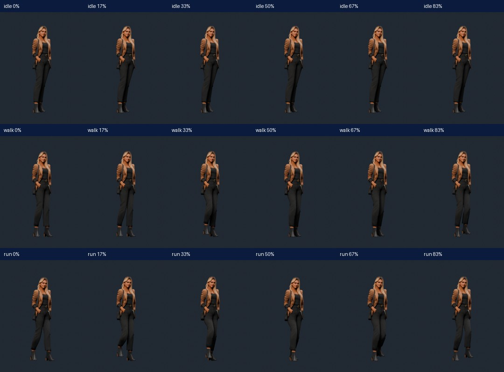
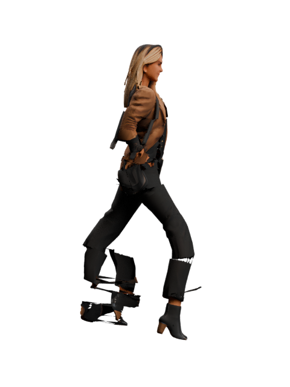
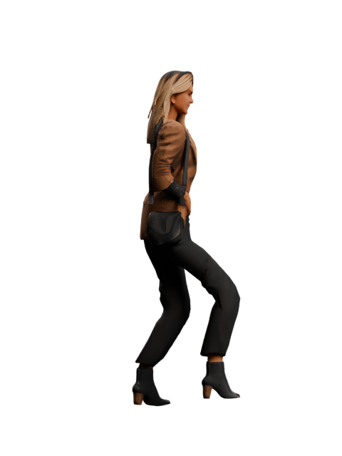

# Catia — rig corrigé, révision 2

Travail réalisé à partir de `assets/avatars/catia/rig-lab/catia-rig-workbench.blend`, sur `codex/catia-mobile-preparation`. Aucun nouveau personnage, aucune génération, aucune utilisation de Krea. Le fichier d'entrée et le GLB original sont conservés ; les corrections sont dans des fichiers versionnés séparés.

## Fichiers livrés

- [Blender corrigé](../../../../assets/avatars/catia/rig-lab/revision-2/catia-corrected.blend) : squelette, poids et trois actions corrigées ; Idle sélectionné par défaut, 30 fps.
- [GLB animé corrigé](../../../../assets/avatars/catia/rig-lab/revision-2/catia-corrected.glb) : 24 996 triangles, 17 os, 4 influences maximum par sommet, texture JPEG 2048×2048 embarquée, environ 1,74 Mo.
- [Mesures avant/après](../../../../assets/avatars/catia/rig-lab/revision-2/correction-report.json).
- [Contrôle du GLB réimporté](../../../../assets/avatars/catia/rig-lab/revision-2/roundtrip-report.json).
- [Vérification structurelle et intégrité](../../../../assets/avatars/catia/rig-lab/revision-2/verification.json).

Catia n'est pas activée dans Vestige. Aucun fichier de carte, GPS, XP, carnet ou sélection d'avatar n'est modifié. L'aperçu existant dans l'application n'est pas remplacé par un nouveau lecteur 3D ; ces nouveaux fichiers restent des assets de préparation.

## Corrections

### Pondérations

La séparation des jambes repose maintenant sur les deux surfaces réellement présentes dans le maillage, sous le bassin, avec continuité au niveau de l'entrejambe. Elle évite d'attribuer des sommets d'une même chaussure aux deux pieds. Les centres des genoux et des chevilles sont recalés sur les sections du modèle existant.

Les poids suivent des transitions anatomiques continues pour hanches, jambes, pieds, torse, manches et mains. Les décisions abruptes selon la couleur de la texture et les troncatures de poids concurrentes sont supprimées. Chaque sommet possède au plus quatre influences conçues dès l'origine, au lieu de supprimer après coup une cinquième influence. Les sommets coïncidents des coutures UV partagent les mêmes poids.

Le visage et le haut des cheveux suivent des transformations rigides ; aucune nouvelle morphologie ou texture faciale n'est créée. Les chaussures restent rigides sur leur partie basse. Le sac et le bas de la veste suivent des transitions progressives plutôt que des influences croisées entre membres.

### Actions

- **Idle, 3 s** : respiration par rotations très discrètes du torse, sans mise à l'échelle du corps ou du visage, et léger mouvement de tête.
- **Walk, 1,2 s** : résolution analytique des jambes vers des cibles de pieds ; alternance d'appuis, levée du pied et passage continu entre les phases. Les mains suivent des cibles proches des poches, sans tirer artificiellement la veste.
- **Run, 0,8 s** : jogging plus rapide, flexion accrue, légère inclinaison du torse et pas conservateurs adaptés à la pose et aux bottines. Ce n'est pas un sprint avec les bras libres.

Les poses sont réellement calculées, puis enregistrées en clés à 30 fps. Les contraintes de calcul ne sont pas nécessaires au lecteur final : le GLB contient les transformations de ses os. Les trois animations sont de vraies actions, pas de simples noms. Le GLB utilise explicitement la pose de repos comme référence de skinning, afin de ne pas figer accidentellement une pose de course comme pose de base.

## Fidélité

Aucun sommet du modèle de repos, aucune face, aucun UV et aucune texture n'est modifié par cette correction. Les empreintes de géométrie/UV avant et après sont identiques. La différence maximale de position au repos après changement du rig est de l'ordre de 0,00018 mm (arrondis flottants). La texture est identique octet pour octet à celle du GLB original.

L'apparence au repos est préservée ; les changements visibles en mouvement proviennent du squelette et des nouvelles actions. Les matériaux et textures ne sont pas régénérés.

## Résultats automatiques

Les mêmes critères de déformation sont utilisés avant/après ; les seuils ne sont pas assouplis pour valider la correction. Tous les frames et demi-frames des actions corrigées sont échantillonnés : 180 poses Idle, 72 Walk et 48 Run. Le fichier GLB exporté est ensuite réimporté dans une nouvelle scène Blender et contrôlé à nouveau.

| Mesure maximale | Avant | Après, scène corrigée |
|---|---:|---:|
| Idle : étirement au 99e percentile | 1,016× | 1,010× |
| Walk : étirement au 99e percentile | 2,006× | 1,196× |
| Run : étirement au 99e percentile | 3,813× | 1,265× |
| Pénétration globale du sol, Walk | 6,87 mm | 0,056 mm |
| Pénétration globale du sol, Run | 4,90 mm | 0,807 mm |

Contrôles complémentaires :

- Arêtes individuelles sous le seuil supplémentaire de 2× ; le pire cas résiduel de Run est proche de ce seuil (≈1,997×), ce n'est donc pas une garantie de simulation textile parfaite.
- Continuité des coutures UV : écart inférieur à 0,02 mm.
- Appuis des semelles pendant Walk/Run : erreur inférieure à 2 mm. Ce contrôle n'est pas annoncé comme mesuré pour le rig précédent ou pour Idle ; ces champs sont explicitement non applicables dans les rapports.
- Boucles fermées : différence des sommets entre début/fin inférieure à 0,01 mm.
- Poids finis, positifs, normalisés ; quatre influences par sommet.
- Trois clips avec données réellement variables, temps croissants et quaternions normalisés.
- Même résultat après export/réimport glTF ; format autonome, sans texture distante.
- Original et Blender source vérifiés par empreinte.
- 42 tests Node réussis ; TypeScript et ESLint sans erreur. La compilation Python est vérifiée également.

Les limites chiffrées sont des contrôles de préparation, pas une certification anatomique ou un benchmark iPhone. Les étirements très localisés proches de 2× restent à apprécier artistiquement sur les vêtements.

## Rendus visuels

Les images `before/` et `after/` sont produites sous le même éclairage et cadrage, en face et profil, à quatre phases par action. Les vidéos ci-dessous sont calculées à partir du **GLB corrigé réimporté**, pas d'un faux aperçu animé : chaque cycle est répété trois fois.

- [Vidéo Idle](idle-review.mp4)
- [Vidéo Walk](walk-review.mp4)
- [Vidéo Run](run-review.mp4)



| Course : avant | Course : après |
|---|---|
|  |  |

Les poses face/profil et la planche d'images du GLB ont été examinées. Les vidéos rendent la cadence et les boucles consultables ; elles ne remplacent pas une validation sur téléphone.

## Limites et suite

- Aucune activation dans l'application : les indicateurs `mapEnabled`, `deviceTested` et `productionApproved` restent faux.
- Aucun iPhone/Android physique connecté ici : rendu temps réel du lecteur, fluidité, mémoire et batterie restent à mesurer sur appareil. Le GLB est préparé avec un budget mobile, mais aucun chiffre de FPS matériel n'est inventé.
- Les mains restent proches des poches conformément au modèle existant. Une course avec grands mouvements de bras ou une ouverture des mains demanderait de revoir les contacts poches/veste et le rig détaillé des doigts ; cela n'est pas prétendu réalisé.
- Pas de simulation de tissu, de rig facial détaillé ou de garantie exhaustive contre toutes les collisions. Le visage et la coiffure existants sont conservés.

Dans Blender, les actions corrigées s'appellent `idle`, `walk`, `run`. Examiner une action à la fois ; les pistes NLA sont muettes dans le fichier de travail pour éviter leur superposition. Les durées à 30 fps correspondent aux plages 1–91, 1–37 et 1–25.

## Reproduire les contrôles

La correction refuse d'écraser son rapport existant ; choisir un nouveau dossier de sortie si l'on refait une variante.

```powershell
blender --background --python-exit-code 1 --python scripts/avatars/catia/revision2/correct.py -- --output C:\temp\catia-rig-test --renders C:\temp\catia-rig-renders
# Les vérifications ci-dessous ciblent les fichiers livrés dans revision-2.
blender --background --python-exit-code 1 --python scripts/avatars/catia/revision2/verify_export.py
node scripts/avatars/catia/revision2/audit.mjs
npm test
npm run typecheck
npm run lint
```

Les scripts de rendu/encodage de vidéos sont fournis dans le même dossier. Ils utilisent un dossier temporaire pour les images ; `--frames` permet de le choisir et `encode_review.py --output` permet de choisir un nouveau dossier de vidéos. L’encodage et la planche d’images demandent FFmpeg et Pillow ; ces outils ne sont pas nécessaires pour lire les fichiers déjà livrés. Blender et FFmpeg travaillent localement ; aucun service de génération ou abonnement n'est utilisé.
