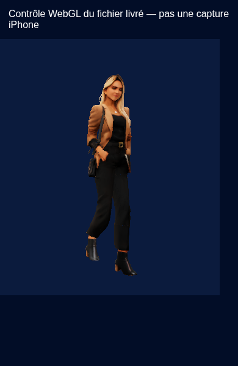

# Prévisualisation native Catia et livraison ZIP

Voir [la procédure Windows/iPhone](../../LANCER_IPHONE_WINDOWS.md).

## Changements

- `Catia3DPreview.tsx` : Canvas natif React Three Fiber / expo-gl, vrai GLB corrigé, AnimationMixer, Idle/Walk/Run, pause, rotation et zoom.
- `catiaPlayback.ts` : contrôleur partagé avec les tests, conserve la pose en pause, sélectionne une vraie action.
- `catiaScene.ts` : instanciation isolée du squelette et des ressources, conservation du type de texture Expo GL, nettoyage sans détruire la scène mise en cache.
- `catiaViewer.ts` : plages de caméra et noms de clips.
- `CatiaViewerBoundary.tsx` : repli vers les images si le chargement ou le contexte 3D échoue.
- `catia.tsx` : mode 3D ou images, informations de la révision corrigée ; profil : accès direct supplémentaire.
- `metro.config.js`, `src/types/assets.d.ts` : chargement du GLB comme asset, sans dépendance distante.
- Dépendances : expo-gl ~58.0.4, @react-three/fiber 9.8.2, three 0.187.0 ; types Three et ngrok pour le développement. Aucun module natif non fourni par Expo Go n'est ajouté pour l'aperçu.

La carte, le joueur actif, le GPS, les données historiques et les règles XP ne sont pas modifiés. Aucune source Catia n'est régénérée et le fichier GLB reste identique.

## Limites vérifiées

Le SDK 58 utilise par défaut un tunnel Expo authentifié : `npx expo login` est nécessaire pour `npx expo start --tunnel`. L'essai anonyme renvoie cette erreur attendue. L'alternative ngrok a expiré/fermé sa session depuis le réseau Cloud ; ne pas présenter ce test comme un succès. La procédure donne aussi l'alternative LAN.

Le contrôle navigateur joint est réalisé sur Chromium avec WebGL logiciel. Il emploie le fichier GLB réel, le contrôleur et les helpers de scène/caméra du projet, et vérifie que Walk bouge, que la pause fige la pose et que Run est distinct. Il ne teste pas le pont Expo GL, les particularités de textures natives ou le GPU de l'iPhone.

Source de compatibilité SDK : https://docs.expo.dev/versions/v58.0.0/sdk/gl-view/
